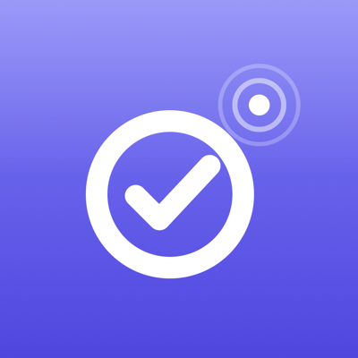
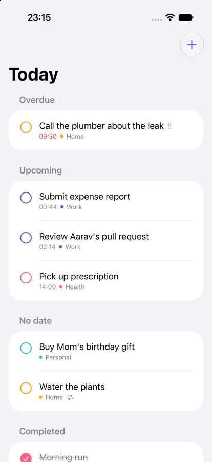
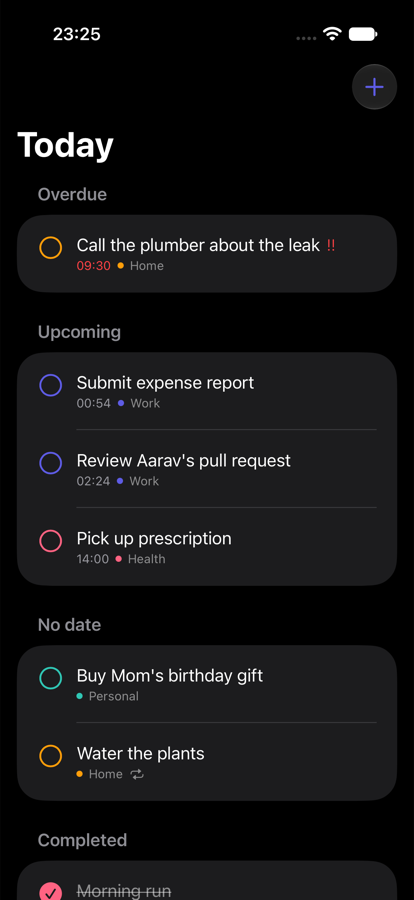

<p align="center">
  
</p>

<h1 align="center">Pinglet</h1>

<p align="center"><strong>A calm to-do &amp; reminders app for iPhone — on your home screen, entirely on your device.</strong></p>

<p align="center">
  Pinglet keeps your day as one glanceable list grouped by when things are due, pings you with a
  local notification at the right time, and puts an <strong>interactive widget</strong> on your home
  screen so you can tick tasks off <em>without opening the app</em>. No account, no server, no internet.
  Built in SwiftUI for iOS&nbsp;26 (Liquid&nbsp;Glass).
</p>

<p align="center">
  
  
  
  
  
  
</p>

<p align="center">
  
  &nbsp;&nbsp;&nbsp;
  
</p>

## What it is

Pinglet is a personal task manager that does one thing well: get the right task in front of you at the right time.

- **Capture** a task with a title, a list, a priority, a due time, and an optional repeat.
- **See your day grouped automatically** — Overdue, Today, Upcoming, No date, Completed — with the important things on top.
- **Get reminded** by a local notification at the time you set, even when the app is closed.
- **Glance and go:** your next tasks sit on the home screen, and a tap completes one without ever opening the app.

Everything lives on your device. There is no account, no sign-in, and no network call.

## Features

| | |
|---|---|
| ✅ **Tasks** | Add, edit, complete, swipe to delete |
| 🗂️ **Lists** | Work · Personal · Home · Health, each colour-coded |
| 🚩 **Priority** | None / Low / Medium / High — higher priority sorts to the top of its section |
| ⏰ **Reminders** | A local notification at the set time; it cancels itself when you complete the task |
| 🔁 **Repeats** | Daily / Weekdays / Weekly recurring reminders |
| 🧩 **Widget** | Small, medium and large — your next tasks on the home screen |
| 👆 **Interactive** | Tap a task's circle on the widget to complete it, no app launch (iOS 26 App Intents) |
| 🌗 **Appearance** | Light and dark, following the system |
| 🪟 **Liquid Glass** | Native iOS 26 look and feel |
| 🔒 **Private** | 100% on-device — no account, server or network |

## Screenshots

| Today — light | Today — dark |
|:---:|:---:|
|  |  |
| Tasks grouped by Overdue / Today / Upcoming / No date, with colour-coded lists, a red **‼︎** on high-priority items and a **⟲** on repeating ones. | The same, following the system's dark appearance, with the Liquid-Glass add button. |

## Tech stack

- **SwiftUI** — the entire UI
- **SwiftData** — on-device persistence (`@Model`)
- **WidgetKit + App Intents** — the interactive home-screen widget
- **UserNotifications** — local reminders, including repeats
- **App Group** — the app and the widget share one database
- **XcodeGen** — the project is defined in `project.yml` (text), not a checked-in `.xcodeproj`

See [docs/ARCHITECTURE.md](docs/ARCHITECTURE.md) for how the pieces fit together.

## Build &amp; run it yourself

You need a **Mac** with **Xcode 26 or newer** and **[XcodeGen](https://github.com/yonaskolb/XcodeGen)**.

```bash
# install XcodeGen once (Homebrew)
brew install xcodegen

git clone https://github.com/Saaamyak/Pinglet.git
cd Pinglet
xcodegen generate          # creates Pinglet.xcodeproj from project.yml
open Pinglet.xcodeproj
```

In Xcode, pick an **iPhone simulator** and press **▶ Run**.

> **`Pinglet.xcodeproj` is generated and git-ignored** — always run `xcodegen generate` after cloning or editing `project.yml`. Never hand-edit the `.xcodeproj`.

### On a real iPhone

Select your iPhone as the destination, set your own **Team** under *Signing &amp; Capabilities* (a free Apple ID works), and press Run. On a **free** Apple ID the signing certificate expires every 7 days; `scripts/refresh.sh` rebuilds and reinstalls in one step (your tasks are kept). A paid Apple Developer Program membership removes the weekly step.

## Project structure

```
Pinglet/
├── project.yml            # XcodeGen — the source of truth for the project
├── Shared/                # Code used by BOTH the app and the widget
│   ├── TodoItem.swift     #   the SwiftData model
│   ├── TaskList.swift     #   lists + colours   · Priority.swift · RepeatRule.swift · Bucket.swift
│   ├── SharedModelContainer.swift   # the App Group database
│   ├── NotificationManager.swift    # scheduling + repeats
│   ├── AppGroup.swift
│   └── ToggleTaskIntent.swift        # the interactive-widget action
├── Pinglet/               # The app target
│   ├── PingletApp.swift · Views/ (TodayView, TaskRowView, AddEditTaskView)
│   └── Assets.xcassets/   # app icon
├── PingletWidget/         # The widget target (timeline, views, small/medium/large)
├── scripts/refresh.sh     # one-step rebuild + reinstall for a free Apple ID
└── docs/                  # architecture + screenshots
```

## Privacy

Pinglet stores your tasks only on your device, in an on-device SwiftData database shared between the app and its widget through an App Group. There is no account, no server, no analytics and no network access of any kind.

## Roadmap

- A **Lists** screen to filter by Work / Home / Health / Personal
- Custom Liquid-Glass touches and motion (a floating glass add button, small animations)
- A **lock-screen** widget
- Optional **iCloud sync** across devices (requires a paid Apple Developer Program membership)

## License

[MIT](LICENSE) © Samyak Goel
